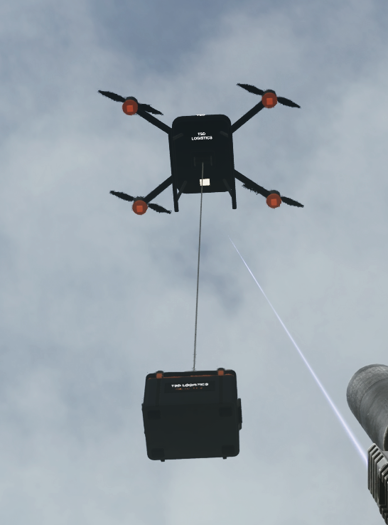

# Tactical Supply Drops Logistics 3.1.0

[Download 3.1.0](https://github.com/NomadTribals/TacticalSupplyDrops/releases/tag/v3.1.0)

An app for the TSD Technologies Field Terminal. Select supplies from the stash or purchase trader stock through Procurement, then arrange delivery during a raid.

## Delivery options

**Standard** supports general cargo, with aircraft delivery on supported maps and ground couriers on Factory, Labs and Ground Zero. **Drone** supports ammunition, medical supplies, food and drinks in a compact 4 × 3 crate, up to 5 kg, where a safe outdoor route is available.

Procurement follows normal trader restrictions and currencies, including compatible custom traders. Trader purchases go to the stash; select and confirm them in Cargo to add them to a shipment. Confirmed orders can share a delivery when capacity permits. Each confirmed order is charged separately.

See [release notes](docs/Release-notes.md) and [installation instructions](docs/Clean-install.md).

## Requirements

- SPT 4.1.6
- TSD Technologies 1.0.0 or newer within 1.x
- Anvil WebOverlay 1.12.0 or newer, with the tablet's dependencies

Dynamic Maps is optional. Fika compatibility is unverified.

## Credits

Special thanks to Kedzie for suggesting drone delivery. Thanks to maschine for Anvil WebOverlay, which makes the tablet interface possible.
