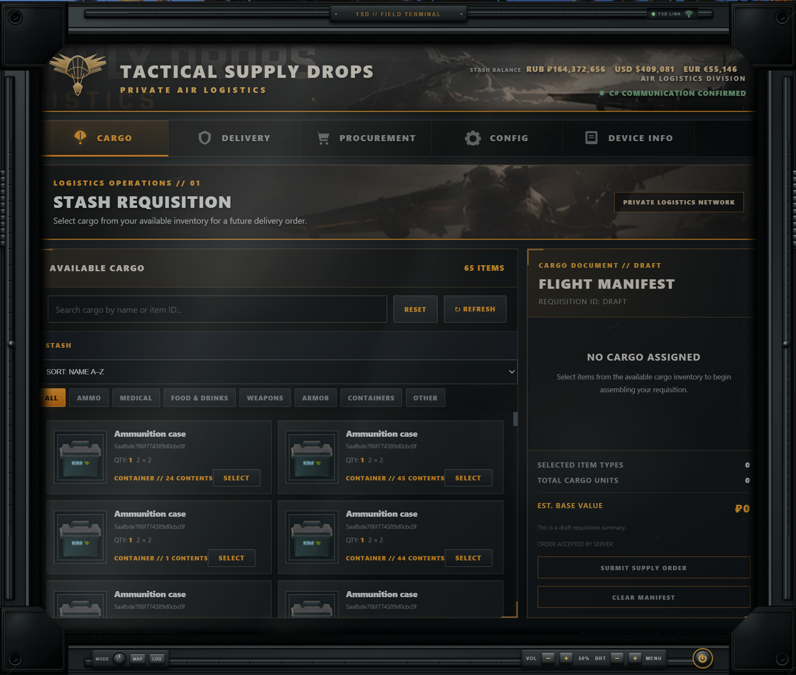

# Tactical Supply Drops 2.0

**TSD has evolved. Welcome to the next generation of private air logistics.**

Tactical Supply Drops has modernized its operations. The original standalone logistics interface has been retired and replaced by our proprietary **TSD Field Terminal**: a rugged tablet available from **Mechanic at loyalty level 1**, with a base price of **75,000 roubles** before normal trader discounts.

Your cargo, traders, and delivery controls are now together in one device. Prepare supplies before deploying, place orders during a raid, and request delivery when you need it.

**Flare signaling is no longer required.** Through the terminal's GPS link, TSD triangulates your position and tasks an aircraft to the nearest valid delivery point. Carry the tablet, confirm your cargo, and let our logistics team handle the rest.

## Field Terminal Guide {.tabset}

### Features

#### Your own TSD Field Terminal

- A custom tablet model and inventory icon, with a dedicated TSD operating interface.
- Purchase through **Mechanic LL1** for a base price of **₽75,000**.
- Open the tablet from the menus or during a raid. Carry it in your PMC inventory to access it in the field.
- Move and resize the tablet window to suit your screen.

#### Five operational tabs

- **Cargo:** Search and browse your stash, navigate containers, select quantities, and build your flight manifest. Review and confirm the delivery fee before submitting your order. Cargo supports a maximum delivery footprint of **60 inventory cells**, with delivery pricing affected by Fence reputation.
- **Delivery:** Authenticate the field link, confirm dispatch, and follow the terminal's communications as your aircraft is tasked. New cargo directs you to the next manifest instead of leaving you on a previously dispatched order.
- **Procurement:** Browse vanilla and installed custom traders in their own sections. Purchase supplies for your next cargo manifest while retaining normal trader prices, loyalty and quest requirements, stock, and purchase limits.
- **Config:** Change the tablet's open/close key and enable or disable its interface sounds.
- **Device Info:** View terminal identity, firmware, ownership information, and the installed mod version.

#### Tablet controls and feedback

- Dedicated **brightness** buttons adjust the display for day or night use.
- **Volume** buttons control tablet audio, including clicks, tab tones, order feedback, and background device sounds.
- A **power button** controls the tablet's power sequence.
- Separate **RUB, USD, and EUR** balances, with currency labels on trader prices.
- TSD cargo crates emit **orange smoke** to help you locate your shipment.

### How It Works

1. **Get connected.** Buy the TSD Field Terminal from Mechanic. Open it with **F9 by default**, or your configured key. You can change this in Config.
2. **Source your supplies.** Use Procurement to buy from a trader, or select supplies you already own on Cargo. Purchased goods are staged in your stash and selected in the cargo draft.
3. **Confirm the manifest.** Review Cargo and submit your supply order. The trader purchase and cargo delivery fee are separate transactions: buying supplies alone does not confirm a shipment.
4. **Take the terminal into a raid.** Orders can be prepared before or during a raid. Dispatch requires an active raid and the terminal in your PMC inventory.
5. **Request delivery.** Open Delivery and confirm cargo delivery. TSD uses the terminal's position to select a valid nearby delivery point and task the aircraft. No flare cartridge or flare gun is needed.
6. **Recover your shipment.** Follow the aircraft and look for the cargo crate's orange smoke. Open the crate and collect your supplies.
7. **Order again when needed.** Review and confirm your next cargo manifest, then dispatch the new accepted order. Each accepted order can be dispatched once.

**Custom traders:** Installed traders are discovered automatically. Their own currencies and normal restrictions apply. Specialized dogtag or functional-item barters marked **USE TRADER ITEM PICKER** must be completed through the game's normal trader screen.

### Requirements

- **SPT 4.1.6**.
- **[Anvil WebOverlay 1.11.0](https://github.com/maschine34675/WebOverlay/releases)**, installed separately.
- A **TSD Field Terminal** to access the service; carry it in your PMC inventory during a raid.
- A map with a supported airdrop delivery point. Delivery on maps without normal airdrops is planned for a future update.

**Fika compatibility has not been confirmed.**

### Installation

1. Close the game and SPT server.
2. Install the required **Anvil WebOverlay** dependency according to its instructions.
3. Download **TacticalSupplyDrops-2.0.0.zip** from the [GitHub release](https://github.com/NomadTribals/TacticalSupplyDrops/releases/tag/v2.0.0).
4. Extract the archive into your **main SPT installation folder**, alongside `EscapeFromTarkov.exe`.
5. Merge the included **BepInEx** and **SPT_Runtime** folders and replace the existing Tactical Supply Drops files.
6. Start the server, then launch the game.

**Do not extract the archive directly into SPT_Runtime.** Both the client plugins and server files must be installed in their included locations. The Field Terminal bundle is included in the archive.

**Upgrading:** Back up your profile first. Keep your existing configuration and order data. Your previously configured tablet key is preserved; a fresh installation defaults to F9.

### Coming Next

TSD is continuing to expand its field logistics service. Planned updates include:

- **Screen customization:** More ways to personalize the tablet's display and appearance.
- **Expanded delivery coverage:** The ability to request supplies on maps that do not normally support airdrops.

These are planned features and are **not included in version 2.0.0**. Release timing will be announced as development progresses.
