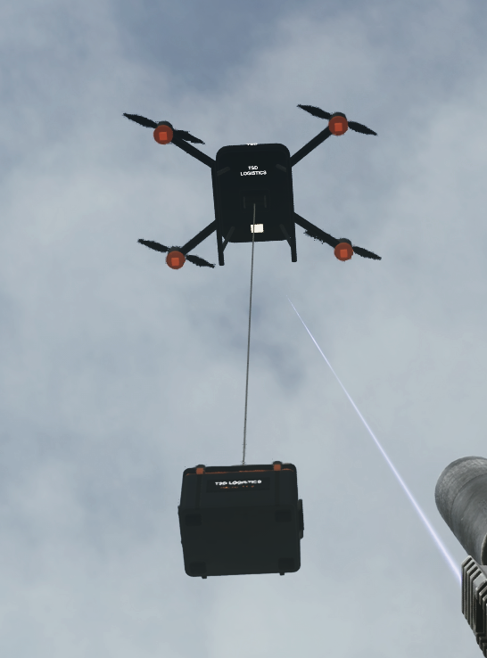
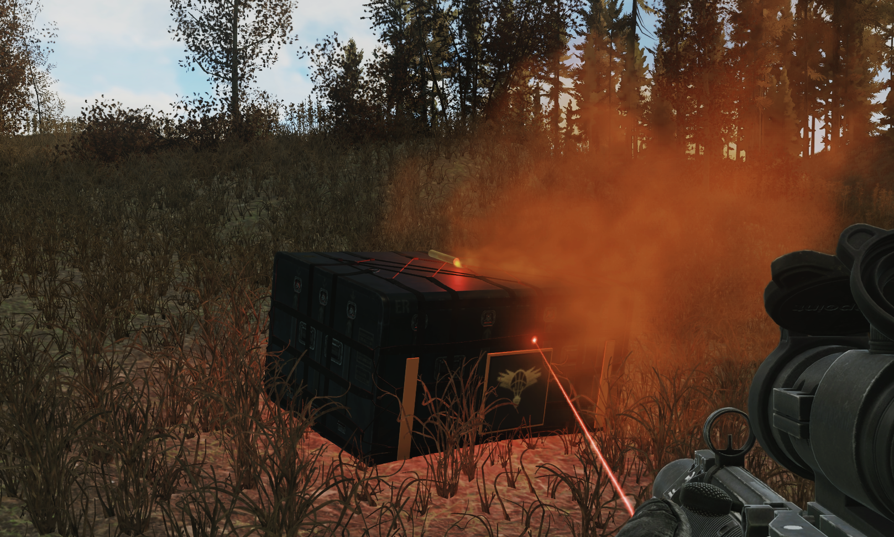
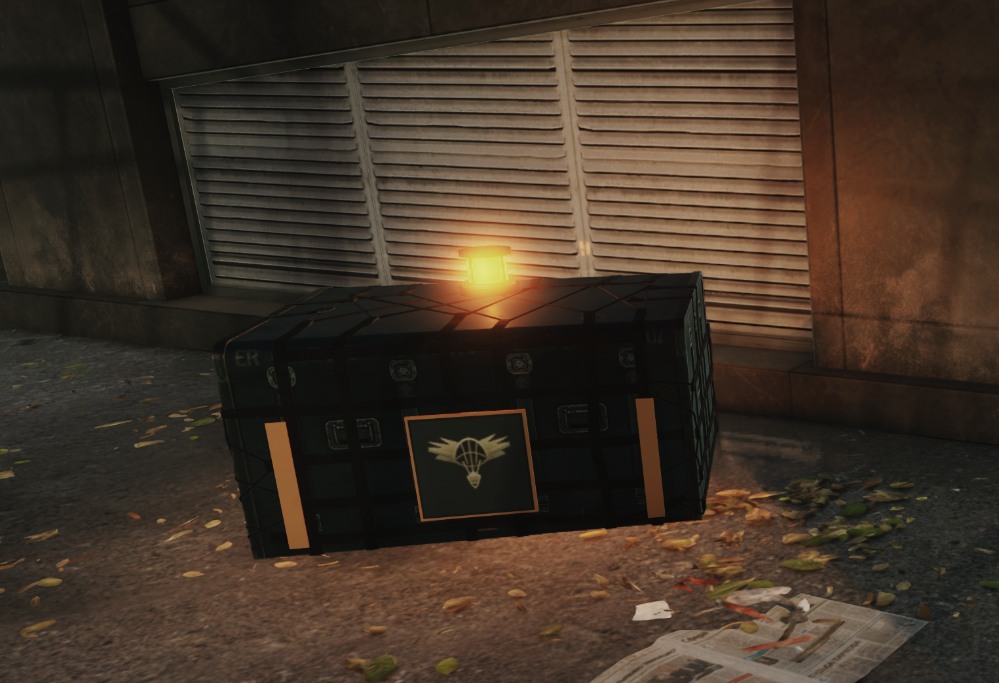

# TSD Logistics — Tactical Supply Drops

**Private logistics. Wherever the raid takes you.**

Prepare supplies from the stash, purchase trader stock and request delivery through the TSD Technologies tablet. Choose a full cargo shipment or a compact drone delivery for essential supplies.

**Requires the separate [TSD Technologies tablet](https://sp-mod.com/mod/3336/tsd-technologies) and Anvil WebOverlay.** For the older standalone tablet setup, use Tactical Supply Drops 2.1.0 instead of combining it with the addon.

## Cargo Preview {.tabset}

### Drone Delivery

A compact, branded equipment crate delivered by a TSD drone, with winch lowering, lifting rigging, navigation lights and a handoff spotlight.

### Air Cargo

Standard cargo arrives by aircraft on supported maps. Orange smoke helps locate the crate.

### Ground Courier

Factory, Labs and Ground Zero use a secure ground courier handoff for Standard Delivery. Tablet guidance, a flashing beacon and a configurable beeper help locate the crate.

## Logistics Guide {.tabset}

### Features

- Select supplies from the stash, including ammunition stored inside cases.
- Choose ammunition quantities from the combined total rather than searching individual stacks.
- Purchase from supported standard and custom traders through Procurement, following normal loyalty, quest unlocks, prices, currencies and purchase limits.
- Combine confirmed orders into a delivery when capacity permits.
- Order in the menus or during a raid; dispatch delivery during a raid while carrying the tablet.
- Follow delivery communications and location guidance from the Delivery screen.
- Optional Dynamic Maps markers help locate delivered cargo. Dynamic Maps is not required.
- A failed dispatch retains cargo for another attempt.

### How It Works

1. Open Logistics on the tablet and select items in Cargo. Procurement purchases enter the stash and can then be selected for cargo.
2. Choose Standard or Drone Delivery, review the weight and fee, then confirm the order.
3. Additional confirmed orders can join the shipment when service and capacity permit. Each confirmed order is charged separately.
4. During a raid, open Delivery and dispatch the shipment. Follow the communications and locate the crate to collect supplies.

Flare signalling is not required. The tablet supplies the position link.

### Delivery Options and Fees

**Standard Delivery:** general cargo with a 60-cell capacity. Aircraft serve supported maps; couriers serve Factory, Labs and Ground Zero. Base fee: **₽5,000 + ₽1,000/kg**.

**Drone Delivery:** ammunition, medical supplies, food and drinks in a **4 × 3 crate, up to 5 kg**. Eligibility, dimensions and capacity are checked before purchase. A clear outdoor route is required. Base fee: **₽2,000 + ₽500/kg**.

Fence reputation adjusts delivery fees. Item value is separate from the delivery fee.

Factory and Labs do not support drone flights. A paid drone order can be converted to courier service from Delivery: the tablet shows the courier total, credits the amount already paid and requests confirmation of any balance due.

### Requirements

- SPT 4.1.6
- TSD Technologies **1.0.0 or newer within 1.x**; the latest release is recommended
- Anvil WebOverlay 1.12.0 or newer and the tablet's dependencies

Dynamic Maps is optional. Fika compatibility remains unverified.

### Installation

Finish pending deliveries before upgrading. Close the game and server and back up the profile.

Download **Tactical Supply Drops 3.1.0** and extract into the SPT game folder containing EscapeFromTarkov.exe. Merge BepInEx and SPT_Runtime and replace existing Logistics program files. Preserve existing order state and player settings. Do not extract only inside SPT_Runtime.

Install TSD Technologies separately. When migrating from the older standalone 2.x version, remove its old program files first so duplicate plugins are not loaded. The archive includes detailed installation instructions.

### Settings

Delivery settings are available in F12, including drone preparation time and sound, courier delay and beacon audio. Tablet appearance, volume and device settings belong to TSD Technologies.

### Credits

Special thanks to [Kedzie](https://sp-mod.com/user/5154/kedzie) for suggesting a smaller drone delivery option.

Thank you to **maschine**, author of [Anvil WebOverlay](https://github.com/maschine34675/WebOverlay), for the foundation and support that make the tablet interface possible.
